<a href="https://components.lordicon.com/?utm_source=github&utm_medium=readme&utm_campaign=ui-components&utm_content=repo-banner">
    <picture>
        <source media="(prefers-color-scheme: dark)" srcset=".github/assets/lordicon-ui-components-repo-dark.gif">
        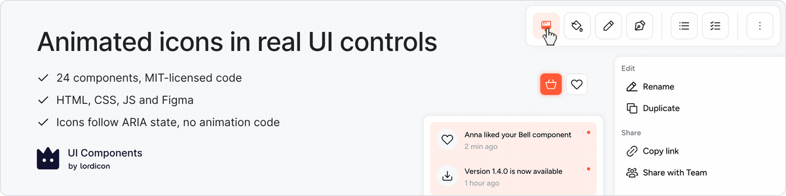
    </picture>
</a>

# Animated UI Components by Lordicon – Free Interactive Components

Lordicon system icons wired into everyday controls: a password field, a menu, a rating, a
button that shows progress, and more. Every demo makes the same point: an icon is a
reaction to the state of a control, and wiring it up is mostly markup.

**[See every component live on components.lordicon.com →](https://components.lordicon.com/?utm_source=github&utm_medium=readme&utm_campaign=ui-components&utm_content=intro-link)**

Application code sets the control's state in the DOM, usually with ARIA. A Lordicon
trigger watches that state and animates the icon. Neither knows about the other.

```html
<button type="button" class="toggle" aria-label="Show password" aria-pressed="false">
    <lord-icon
        src="icons/system-outline-69-eye.json"
        state="morph-close"
        trigger="follow(aria-pressed)"
        target=".toggle"
        aria-hidden="true"
    ></lord-icon>
</button>
```

```ts
toggle.addEventListener('click', () => {
    const show = input.type === 'password';
    input.type = show ? 'text' : 'password';
    toggle.setAttribute('aria-pressed', String(show)); // the icon follows on its own
});
```

## The demos

Each demo has a page on [components.lordicon.com](https://components.lordicon.com/) with the demo
running, the code that matters, and every file it is made of. Click a preview to open it.

### Buttons

| Preview                                                                                                                                                                                                                                                           | Demo                                      | What it shows                                                                                                                                     |
| ----------------------------------------------------------------------------------------------------------------------------------------------------------------------------------------------------------------------------------------------------------------- | ----------------------------------------- | ------------------------------------------------------------------------------------------------------------------------------------------------- |
| <a href="https://components.lordicon.com/demos/add-to-cart/">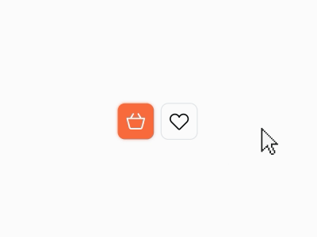</a>                 | [Add to cart](demos/add-to-cart/)         | A product action with an Add to cart button and a heart for saving. The button confirms the item was added, and the heart fills when you save it. |
| <a href="https://components.lordicon.com/demos/button-progress/">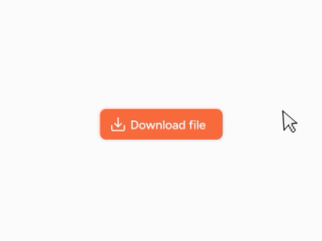</a> | [Button progress](demos/button-progress/) | A button that shows the progress of a download or upload. The icon loops while the file transfers, then a receipt confirms it’s done.             |
| <a href="https://components.lordicon.com/demos/icon-button/">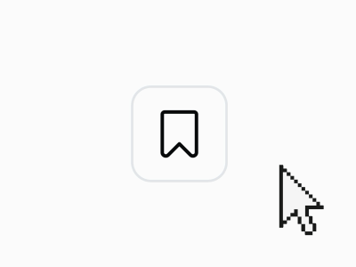</a>           | [Icon button](demos/icon-button/)         | A bookmark button with no label. The bookmark fills when you press it, and a short message confirms the item was saved.                           |
| <a href="https://components.lordicon.com/demos/simple-button/">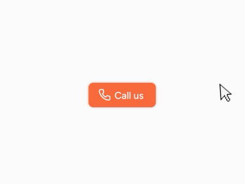</a>                                                                   | [Simple button](demos/simple-button/)     | A Call us button. The phone icon rings when you point at it.                                                                                      |
| <a href="https://components.lordicon.com/demos/star-button/">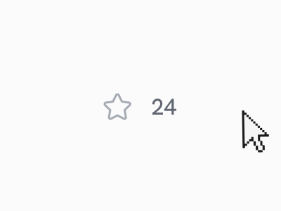</a>                  | [Star button](demos/star-button/)         | A button for starring an item, with a counter. The star morphs into a filled one when you press it, and the count goes up.                        |
| <a href="https://components.lordicon.com/demos/toolbar/">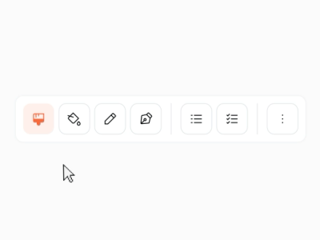</a>          | [Toolbar](demos/toolbar/)                 | A row of tools and formatting options. Icons morph into place as you pick a tool or list style, and play when pressed.                            |

### Forms & Inputs

| Preview                                                                                                                                                                                                                                                             | Demo                                    | What it shows                                                                                                                                                   |
| ------------------------------------------------------------------------------------------------------------------------------------------------------------------------------------------------------------------------------------------------------------------- | --------------------------------------- | --------------------------------------------------------------------------------------------------------------------------------------------------------------- |
| <a href="https://components.lordicon.com/demos/checkbox-list/">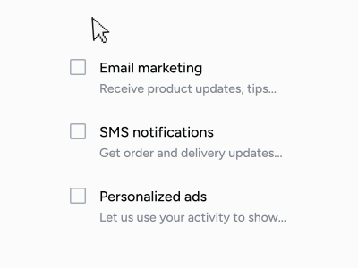</a>                        | [Checkbox list](demos/checkbox-list/)   | A list of options to tick, in three styles. The checkbox icon morphs into a tick when you select it.                                                            |
| <a href="https://components.lordicon.com/demos/input-form/">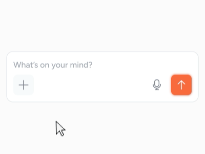</a>                       | [Input form](demos/input-form/)         | A message composer pinned to the bottom of the page. Its menu opens upward, with a submenu and a search inside.                                                 |
| <a href="https://components.lordicon.com/demos/password-field/">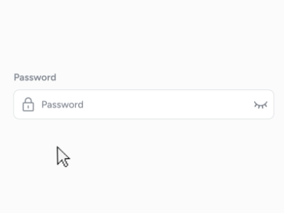</a> | [Password field](demos/password-field/) | A password input with a show/hide toggle and error messages. The lock reacts when you click into the field, and the eye morphs open and closed with the toggle. |
| <a href="https://components.lordicon.com/demos/rating/">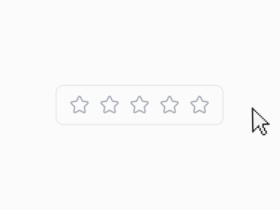</a>                       | [Rating](demos/rating/)                 | A row of five stars for rating something. Stars light up one by one as you hover and morph into filled stars when you pick a rating.                            |
| <a href="https://components.lordicon.com/demos/search-bar/">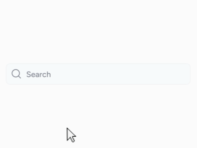</a>                         | [Search bar](demos/search-bar/)         | A search field with a clear button. The magnifier reacts when you click into the field, and the cross icon appears once you stop typing.                        |

### Menus

| Preview                                                                                                                                                                                                                                                                | Demo                                          | What it shows                                                                                                                                             |
| ---------------------------------------------------------------------------------------------------------------------------------------------------------------------------------------------------------------------------------------------------------------------- | --------------------------------------------- | --------------------------------------------------------------------------------------------------------------------------------------------------------- |
| <a href="https://components.lordicon.com/demos/command-menu/">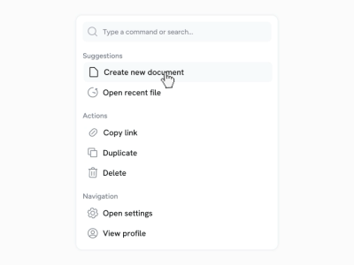</a>           | [Command menu](demos/command-menu/)           | A search palette for jumping to commands, opened with a keyboard shortcut. Icons react as you move through the commands with the mouse or the arrow keys. |
| <a href="https://components.lordicon.com/demos/dropdown-menu/">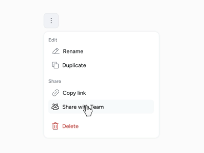</a>                        | [Dropdown menu](demos/dropdown-menu/)         | A menu of grouped actions that opens from a button. Icons react to the mouse and the arrow keys.                                                          |
| <a href="https://components.lordicon.com/demos/notification-menu/">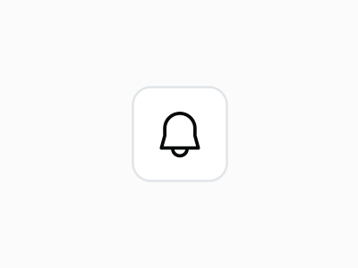</a> | [Notification menu](demos/notification-menu/) | A bell that opens a list of recent notifications. It rings when a new one arrives.                                                                        |

### Navigation

| Preview                                                                                                                                                                                                                                                           | Demo                                            | What it shows                                                                                                                      |
| ----------------------------------------------------------------------------------------------------------------------------------------------------------------------------------------------------------------------------------------------------------------- | ----------------------------------------------- | ---------------------------------------------------------------------------------------------------------------------------------- |
| <a href="https://components.lordicon.com/demos/mega-menu/">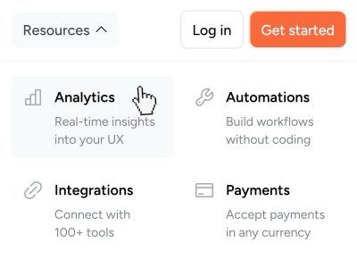</a>               | [Mega menu](demos/mega-menu/)                   | A site header with a Resources menu that opens a wide panel of links. Each tile lights up and plays its icon when you point at it. |
| <a href="https://components.lordicon.com/demos/pagination/">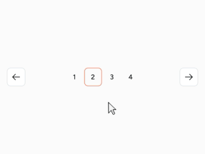</a>                                 | [Pagination](demos/pagination/)                 | Page navigation for long lists, in three button styles. A highlight slides to the page you pick.                                   |
| <a href="https://components.lordicon.com/demos/sidebar-navigation/">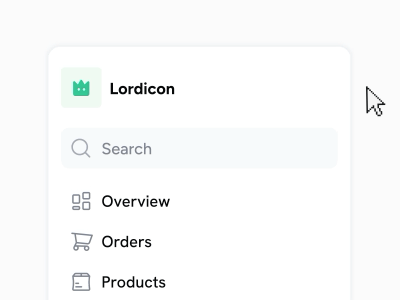</a> | [Sidebar navigation](demos/sidebar-navigation/) | A side menu linking to pages of an app. Icons react to hover and the keyboard, and the current page is highlighted.                |

### Feedback & Progress

| Preview                                                                                                                                                                                                                                         | Demo                                | What it shows                                                                                                      |
| ----------------------------------------------------------------------------------------------------------------------------------------------------------------------------------------------------------------------------------------------- | ----------------------------------- | ------------------------------------------------------------------------------------------------------------------ |
| <a href="https://components.lordicon.com/demos/alert/">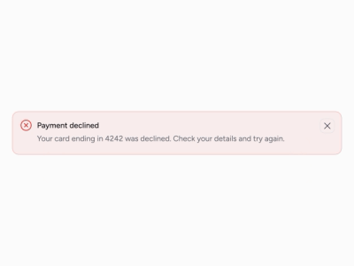</a>  | [Alerts](demos/alert/)              | Short messages about a change or a problem, in four types. Each icon plays as the alert appears.                   |
| <a href="https://components.lordicon.com/demos/loading-list/">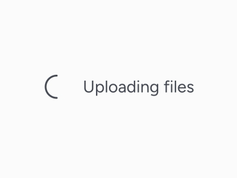</a> | [Loading list](demos/loading-list/) | A checklist showing the steps of a running task. Each spinner turns into a tick or a cross when its step finishes. |

### Containers

| Preview                                                                                                                                                                                                                          | Demo                                | What it shows                                                                                             |
| -------------------------------------------------------------------------------------------------------------------------------------------------------------------------------------------------------------------------------- | ----------------------------------- | --------------------------------------------------------------------------------------------------------- |
| <a href="https://components.lordicon.com/demos/accordion/">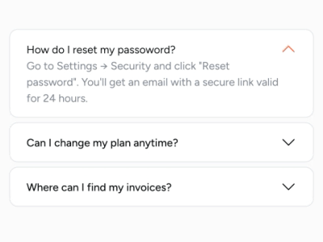</a> | [Accordion](demos/accordion/)       | A stack of headings that each open a section of content. The chevron morphs as a section opens or closes. |
| <a href="https://components.lordicon.com/demos/add-new-card/">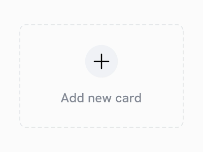</a> | [Add new card](demos/add-new-card/) | An empty, dashed tile for adding a new item to a grid. Its plus icon turns when you hover over it.        |

### Page sections

| Preview                                                                                                                                                                                                                                                 | Demo                                            | What it shows                                                                                                                         |
| ------------------------------------------------------------------------------------------------------------------------------------------------------------------------------------------------------------------------------------------------------- | ----------------------------------------------- | ------------------------------------------------------------------------------------------------------------------------------------- |
| <a href="https://components.lordicon.com/demos/categories-section/">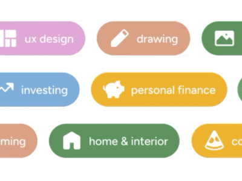</a> | [Categories section](demos/categories-section/) | Three rows of category chips that scroll without end, the middle one the other way. Point at a row to stop it; the chip’s icon plays. |
| <a href="https://components.lordicon.com/demos/pricing/">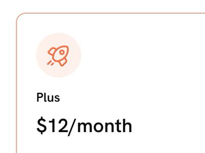</a>                        | [Pricing](demos/pricing/)                       | Cards comparing subscription plans, in four layouts. Each plan’s icon plays when you hover over its card.                             |
| <a href="https://components.lordicon.com/demos/title-with-icon/">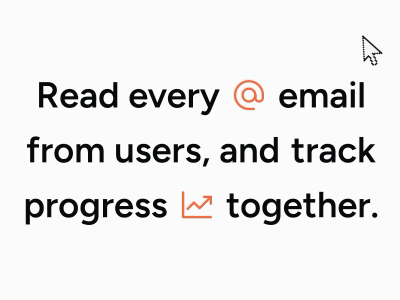</a>            | [Title with icon](demos/title-with-icon/)       | A heading with icons between its words, plain or in a box. The icons play by themselves, one after another.                           |

## Take a demo

Every demo is also a standalone Vite project on the `standalone` branch. Copy one, install,
run:

```sh
npx giget@latest gh:lordicondev/ui-components/password-field#standalone password-field
cd password-field
npm install
npm run dev
```

The demo page offers the same copy as a ZIP and on StackBlitz. Each copy carries its own
`README.md` with the icons' triggers and what to know before adapting it.

## How a demo is built

- `index.html` puts a `<lord-icon>` in the control, with `trigger` naming a behaviour and
  `target` naming the element whose state it follows.
- `main.ts` defines the element, then sets the control's state: an ARIA attribute or a
  `data-*` attribute. It never touches the icon.
- The triggers are built into `@lordicon/element`: `follow` for state, `hover` and `click`
  for the pointer. They read nothing but the target's attributes and native events. The
  one trigger of our own is in `shared/triggers/`; see [shared/README.md](shared/README.md).
- An icon on screen from the start holds an `` of its first frame, which shows until
  the icon is ready. Most load only on the first pointer, click or focus on their control
  (`loading="interaction"`). Before the script runs, `lord-icon:not(:defined)` in
  `shared/styles/base.css` gives the element its final size, so nothing moves.

To add a demo or work on the repo, see [CONTRIBUTING.md](CONTRIBUTING.md).

## Licence

- Code (demos, shared modules, scripts, portal): [MIT](LICENSE.md).
- Icons: [Lordicon License Terms](https://lordicon.com/licenses). The MIT licence does not
  cover them.
- Fonts: Figtree and JetBrains Mono, under the SIL Open Font License (`shared/fonts/OFL-*.txt`).

See [LICENSE.md](LICENSE.md) for the details.
